# Lab Environment Setup — VirtualBox VM Deployment

## Purpose

Deploy a four-VM, two-subnet network security lab with **no bridged or NAT connections**. Kali simulates an external testing host; pfSense routes and filters traffic to a protected Ubuntu/Debian LAN.

> **Security warning:** This lab uses legacy imported appliances, including pfSense CE 2.6.0 with end-of-life PHP 7.4.26. Keep both VirtualBox networks in **Internal Network** mode. Do not expose the appliances or their management interfaces to the internet or a real LAN. Use unique credentials. Inspect and verify OVA provenance before importing; unsigned appliances are not inherently trustworthy.

## 1. Prerequisites

- Oracle VirtualBox installed on the host.
- Four authorized OVA appliances: `VM1_PFSense.ova`, `VM2_Kali.ova`, `VM3_Ubuntu.ova`, and `VM4_Debian.ova` (filenames may vary).
- Sufficient disk space and memory for four concurrent VMs; approximately 12 GB of host RAM available to the lab is a useful starting point, not a strict minimum.
- Access to each guest's credentials or authorization to reset them. 

**Distribution:** OVA images are not stored in this repository. Fully configured snapshots are available upon request. Alternatively - obtain them from a legitimate, authorized source. A clean installation of equivalent guest systems is an alternative, but package versions and steps may differ from this imported-appliance walkthrough.

## 2. Import and configure the VMs

For each appliance:

1. In VirtualBox, select **File → Import Appliance**, choose the authorized OVA, and review its settings before importing.
2. Generate new MAC addresses during import if offered, and use VDI disk conversion if appropriate to your VirtualBox version.
3. Open **Settings → Network** and apply the adapter assignments in the screenshots below **before starting the VM**.
4. Confirm no adapter uses **Bridged Adapter**, **NAT**, or **NAT Network**.

> **Troubleshooting — missing or wrong adapter:** If pfSense sees only one NIC or the WAN/LAN appear reversed, shut down the VM, inspect both VirtualBox adapters, then verify pfSense interface assignments at the console. Confirm `em0` and `em1` correspond to the intended networks before continuing.

### VirtualBox Network Adapter Configuration

Configure each virtual machine's network adapters under
**Settings → Network** using the assignments defined below.

**pfSense — WAN and LAN Adapters**

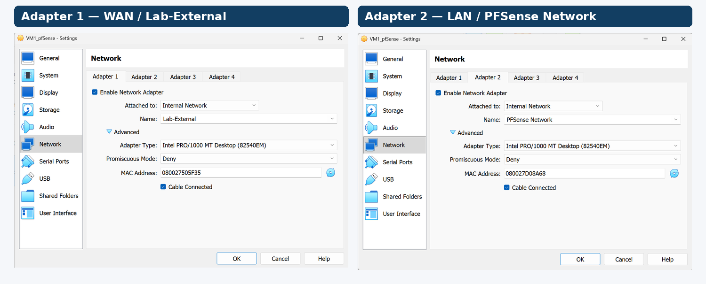

*pfSense uses two VirtualBox Internal Network adapters: Adapter 1 connects to `Lab-External` (WAN), while Adapter 2 connects to `PFSense Network` (LAN). Both use the Intel PRO/1000 MT Desktop adapter with Promiscuous Mode set to Deny.*

**Kali, Ubuntu, and Debian — Endpoint Adapters**

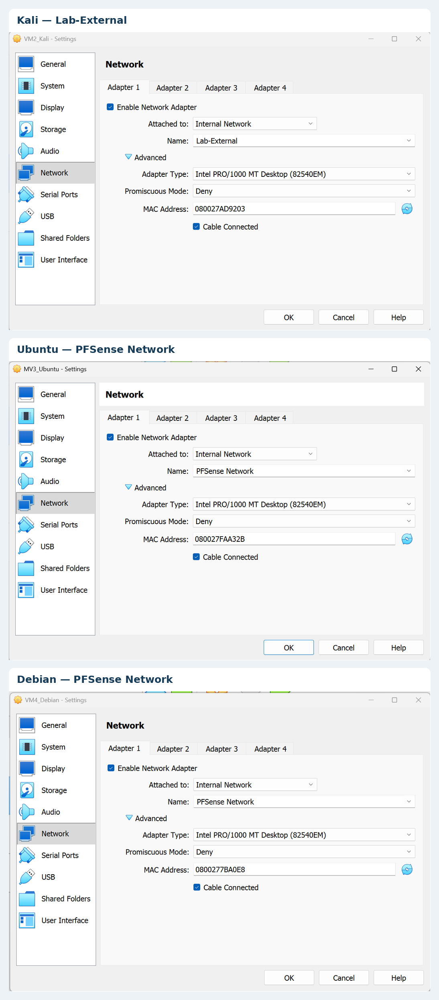

*Kali connects to `Lab-External`, while Ubuntu and Debian connect to `PFSense Network`. All three use Internal Network mode with Promiscuous Mode set to Deny.*

> **Troubleshooting:** VirtualBox Internal Network names must match exactly for VMs to communicate on the same segment. Verify that each adapter is enabled and **Cable Connected** is checked. Do not use NAT or Bridged Adapter, as the lab is intended to remain isolated from external networks.

## 4. Configure pfSense

1. Start pfSense and identify the console interfaces: WAN `em0`, LAN `em1`.
2. From the console, choose **2) Set interface(s) IP address**.
3. Configure WAN (`em0`) with **static IPv4** `192.168.50.1`, prefix **24**, **no upstream gateway**, no WAN DHCP server, and no IPv6 configuration required for these IPv4 tests.
4. Configure or verify LAN (`em1`) as `172.16.77.1/24` with DHCP enabled for the protected network. The DHCP pool must exclude the LAN interface address; the specific pool bounds were not recorded in the original setup.
5. Keep the webConfigurator on **HTTPS** when prompted (do not revert to HTTP).
6. Confirm the console displays the expected WAN and LAN addresses.

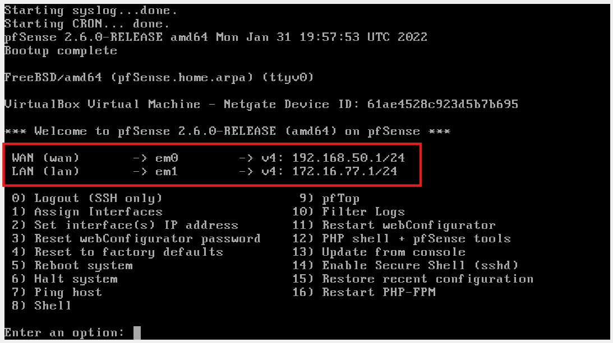

7. From Ubuntu, browse to `https://172.16.77.1`. A self-signed certificate warning is expected. Use the appliance's authorized administrator credentials; pfSense factory defaults, if unchanged, are `admin` / `pfsense`. **Change default credentials** and do not publish the replacement password.
8. Enable the DHCP server on the LAN interface.
5. Configure an IPv4 address pool within the `172.16.77.0/24` subnet, excluding the pfSense LAN address (`172.16.77.1`).
6. Click **Save** to apply the configuration.

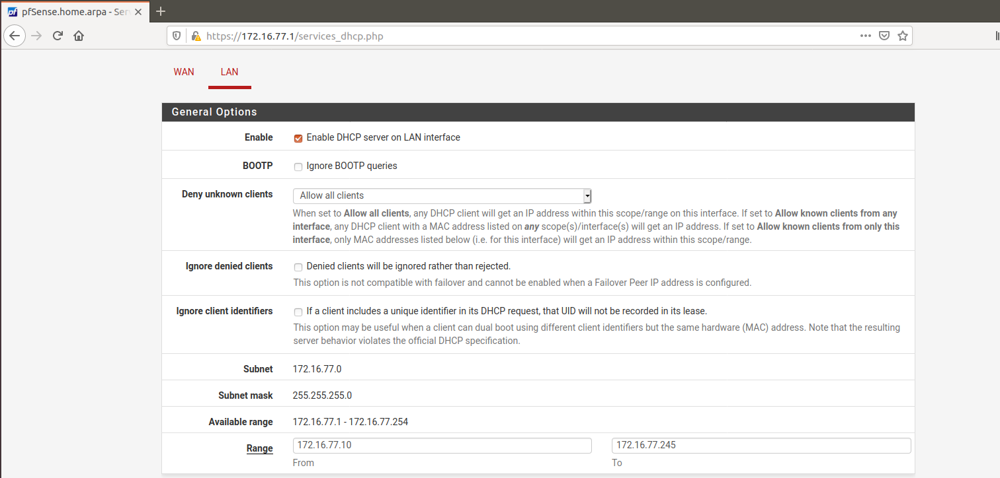

> **Troubleshooting:** If Ubuntu or Debian does not receive an IPv4 address, verify that DHCP is enabled, the address pool is within `172.16.77.0/24`, and both VMs are connected to the `PFSense Network` Internal Network in VirtualBox.

Under **Interfaces → WAN**, verify **Block private networks and loopback addresses** is unchecked for this simulated RFC1918 external subnet. Also verify the bogon-network block setting is appropriate for this isolated test network. The default WAN deny policy should remain in place. Under **System → General Setup**, set timezone to **`US/Eastern`** if New York local time is desired.

> **Troubleshooting — browser certificate warning:** The pfSense webConfigurator may present an untrusted/self-signed HTTPS certificate. Verify that you are visiting `https://172.16.77.1` on the isolated LAN before proceeding through the browser warning. Do not disable certificate checking system-wide.

> **Troubleshooting — DHCP clients have no address:** Check **Services → DHCP Server → LAN**, the LAN interface address, and each guest’s VirtualBox network name. A host receiving an address outside `172.16.77.0/24` is not in the expected baseline.

## 5. Configure Ubuntu and Debian

1. Boot each VM with its only active NIC attached to `PFSense Network`.
2. Log in using authorized credentials. If credentials are unknown, recover them using the guest's documented recovery mechanism rather than guessing or publishing passwords.
3. Confirm each guest receives a DHCP address in `172.16.77.0/24`:

   ```bash
   ip -4 addr
   ip route
   ```

4. Test reachability to the LAN interface:

   ```bash
   ping -c 4 172.16.77.1
   ```

During the documented deployment, Ubuntu received `172.16.77.10` and Debian received `172.16.77.11`. These are **observed DHCP leases**, not documented reservations. For reproducible later exercises, either configure DHCP reservations in pfSense or update the exercise commands to match current leases.

> **Troubleshooting — the IP address changed:** Ubuntu and Debian use DHCP, so `.10` and `.11` are not guaranteed. Recheck `ip -4 addr` and the pfSense DHCP leases before using hard-coded addresses. If `ping 172.16.77.1` fails, verify the guest NIC and DHCP lease before changing firewall rules.

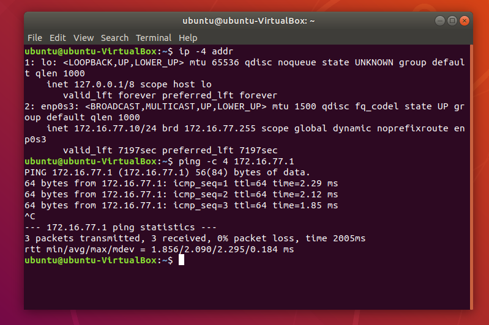

*Ubuntu received `172.16.77.10/24` via DHCP and successfully reached pfSense LAN.*

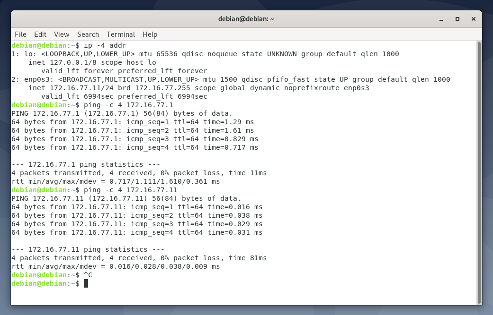

*Debian received `172.16.77.11/24` via DHCP and successfully reached pfSense LAN.*

## 6. Configure Kali's persistent IPv4 address

1. Boot Kali with its NIC on `Lab-External` and identify its interface:

   ```bash
   ip -br addr
   nmcli -f NAME,UUID,TYPE,DEVICE connection show
   ```

2. The imported Kali appliance used interface `eth0` and NetworkManager. Confirm your **connection profile name** before modifying it. The configured profile was also named `eth0`:

   ```bash
   nmcli connection modify "eth0" \
     ipv4.method manual \
     ipv4.addresses 192.168.50.10/24 \
     ipv4.gateway "" \
     ipv4.dns "" \
     ipv4.never-default yes
   ```

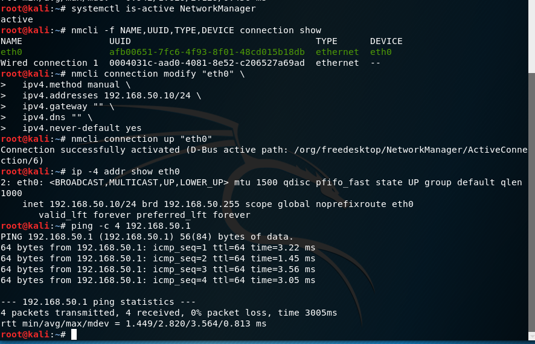

*Kali's NetworkManager profile configured for static `192.168.50.10/24`, with successful ping replies from pfSense WAN. This screenshot does not verify route persistence.*

3. Add a **persistent route** to the protected LAN through pfSense:

   ```bash
   nmcli connection modify "eth0" +ipv4.routes "172.16.77.0/24 192.168.50.1"
   ```

4. Enable automatic startup of the configured profile. On this appliance, an unused profile called `Wired connection 1` otherwise activated after reboot:

   ```bash
   nmcli connection modify "Wired connection 1" connection.autoconnect no
   nmcli connection modify "eth0" connection.autoconnect yes
   nmcli connection up "eth0"
   ```

   Only disable `Wired connection 1` if it is a separate, unused profile on **your** VM.

> **Troubleshooting — static address disappears after reboot:** `ip addr add` changes the running interface but does not make the setting persistent. Check the active NetworkManager connection with `nmcli -f NAME,DEVICE connection show --active`, verify that the intended `eth0` profile autoconnects, and confirm the competing profile is not taking over.

5. Verify:

   ```bash
   nmcli -f NAME,DEVICE connection show --active
   ip -4 addr show eth0
   ip route
   ```

6. Reboot Kali and repeat the checks to verify persistence.

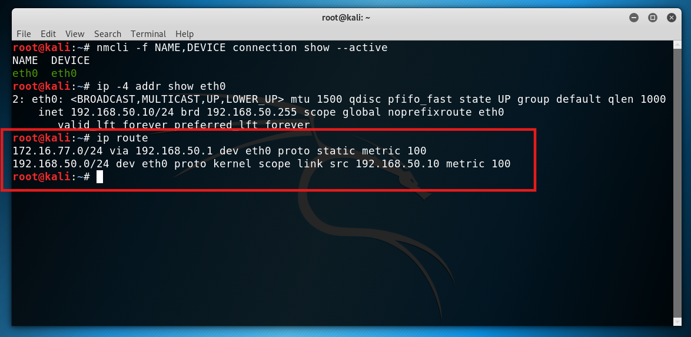

> **Troubleshooting — `Network is unreachable`:** Run `ip route`. Kali needs `172.16.77.0/24 via 192.168.50.1 dev eth0` to reach the protected subnet. If absent, check the saved `ipv4.routes` property with `nmcli -f ipv4.routes connection show "eth0"`, then reactivate the correct connection. This is a routing problem, not evidence that pfSense blocked the packet.

## 7. Configure a narrow pfSense WAN test rule

By default, pfSense denies unsolicited WAN traffic. To verify that Kali can reach the **firewall itself** without permitting general WAN-to-LAN access:

1. Open **Firewall → Rules → WAN** and add a **Pass** rule.
2. Set **Address Family: IPv4**, **Protocol: ICMP**, **ICMP subtype: Echo request** (if available).
3. Set **Source: Single host `192.168.50.10`**.
4. Set **Destination: WAN address**.
5. Description: `Allow Kali ICMP to pfSense WAN`.
6. Save and **Apply Changes**.

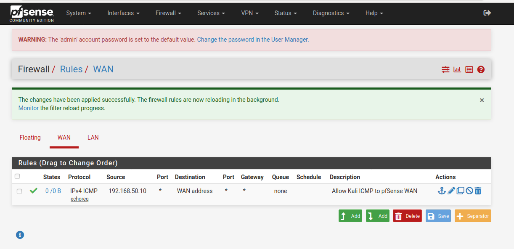

*The WAN rule permits ICMP echo requests from Kali (`192.168.50.10`) to the pfSense WAN address only.*

This rule permits a limited diagnostic test; it does **not** grant access to the protected LAN.

> **Troubleshooting — Kali cannot ping pfSense WAN:** First verify Kali has `192.168.50.10/24`, pfSense WAN has `192.168.50.1/24`, and both adapters use `Lab-External`. Then confirm the WAN rule is enabled, targets **WAN address**, has source `192.168.50.10`, and has been applied. Check firewall logs rather than adding a broad allow rule.

## 8. Validate isolation and firewall enforcement

From Kali:

```bash
# Expected: successful replies from pfSense WAN
ping -c 4 192.168.50.1

# Expected: timeouts under the default WAN deny policy
ping -c 4 172.16.77.10
ping -c 4 172.16.77.11
```

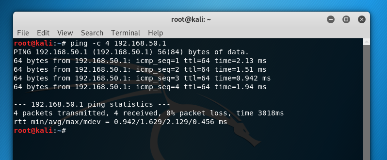

*Kali successfully reaches the pfSense WAN interface after the restricted ICMP rule is applied.*

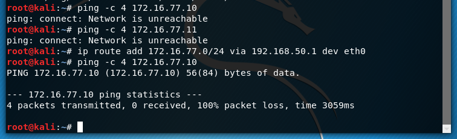

*After a route to the protected subnet is added, Kali's ICMP requests to Ubuntu time out. The firewall logs below establish that pfSense blocked the requests.*

If Kali reports **Network is unreachable** rather than timing out, first check that the route to `172.16.77.0/24` exists. A timeout by itself is not proof of a firewall block; verify the firewall logs.

> **Troubleshooting — LAN ping times out:** This is **expected** when Kali targets Ubuntu or Debian under the default WAN deny policy. Check the source, destination, interface, and rule in pfSense logs. Do not disable the firewall just to make the ping succeed.

> **Troubleshooting — no log entries appear:** Confirm the firewall log time range and any active filters. Earlier in this build, a restrictive time filter hid recent blocked events. Generate one new ping test and inspect the corresponding timestamp.

In pfSense, open **Status → System Logs → Firewall → Normal View**, select a recent time range, and locate entries showing:

| Field | Expected logged value |
| --- | --- |
| Interface | WAN |
| Action | Block |
| Rule | Default deny rule IPv4 |
| Source | `192.168.50.10` |
| Destination | `172.16.77.10` |
| Protocol | ICMP |

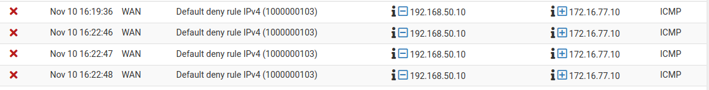

*pfSense firewall logs identify the WAN interface, default deny rule, Kali source (`192.168.50.10`), Ubuntu destination (`172.16.77.10`), and ICMP protocol.*

## Baseline Completion Checklist

Before proceeding to the security exercises, verify the following:

- [ ] All four virtual machines are imported and boot successfully.
- [ ] All network adapters use VirtualBox Internal Network mode.
- [ ] pfSense WAN (`192.168.50.1/24`) and LAN (`172.16.77.1/24`) interfaces are configured correctly.
- [ ] The pfSense LAN DHCP server is enabled.
- [ ] Ubuntu and Debian receive IPv4 addresses from pfSense DHCP.
- [ ] Ubuntu and Debian can successfully ping the pfSense LAN interface.
- [ ] Kali has the static IPv4 address `192.168.50.10/24`.
- [ ] Kali's static IP and route to `172.16.77.0/24` persist after reboot.
- [ ] Kali can successfully ping the pfSense WAN interface.
- [ ] Kali cannot reach Ubuntu or Debian through the default WAN firewall policy.
- [ ] pfSense firewall logs confirm that Kali's WAN-to-LAN traffic is blocked.
- [ ] All virtual machines remain isolated from the internet and physical network.


## 10. Before starting the security exercises

Take a VM snapshot or export a sanitized pfSense configuration as a rollback point. Keep test traffic within the authorized isolated networks. Do not publish OVA images, passwords, private keys, or unsanitized firewall configuration backups. Additional software (Suricata, OpenVPN, Fail2ban, web servers, syslog tooling) must be verified as installed before its corresponding exercise begins.
