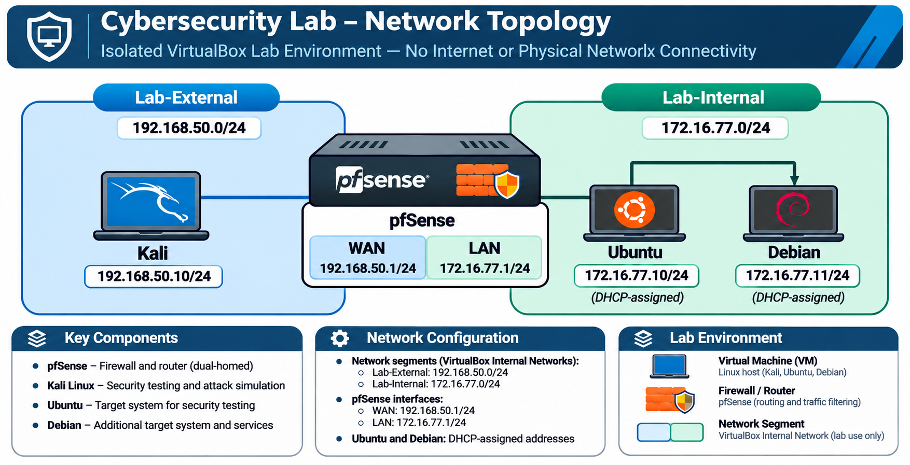

# Network Security Project

_**Project Status:** Core environment configured. Exercise enhancements in progress._

## Overview

A hands-on cybersecurity lab designed to provide aspiring and entry-level professionals with an accessible, reproducible environment for developing practical security skills. Built in Oracle VirtualBox using pfSense, Kali Linux, Ubuntu, and Debian. The project features structured exercises covering network security engineering, traffic analysis, threat detection, system hardening, and incident investigation.

*Preconfigured .ova files are available upon request. However, I would argue that troubleshooting the configuration is just as valuable as completing the tasks, so beginners are encouraged to follow the [Lab Environment Setup](Lab%20Environment%20Setup.md) guide and configure the environment themselves to gain experience with virtualization, networking, system administration and troubleshooting.*

## Network Topology

*The entire lab is isolated from internet and physical network connectivity. **Lab-External** and **Lab-Internal** are separate network segments connected through pfSense; they are not independent internet-connected networks.*

| Component | Purpose | Network / Address |
| --- | --- | --- |
| Kali Linux | Simulated external testing and traffic generation | Lab-External — `192.168.50.10/24` (static) |
| pfSense CE 2.6.0 | Stateful firewall and router | WAN `192.168.50.1/24` · LAN `172.16.77.1/24` |
| Ubuntu | Protected application and test host | Lab-Internal — `172.16.77.10/24` (DHCP-assigned) |
| Debian | Protected service and logging host | Lab-Internal — `172.16.77.11/24` (DHCP-assigned) |

The logical segment names in the diagram are **Lab-External** and **Lab-Internal**. In VirtualBox, their actual *Internal Network* names are `Lab-External` and `PFSense Network`, respectively. The Ubuntu and Debian addresses are currently observed DHCP leases, not guaranteed permanent assignments.

## Verified Baseline

- Deployed four VMs on two VirtualBox Internal Network segments, with no NAT or bridged adapter in the final configuration.
- Configured pfSense WAN/LAN addressing and LAN DHCP.
- Configured Kali's static address and a NetworkManager route to the protected subnet through pfSense.
- Verified Kali can reach pfSense WAN through a narrowly scoped ICMP rule.
- Confirmed pfSense's default WAN deny rule blocks Kali-to-Ubuntu ICMP and records the denied traffic in firewall logs.
- Verified protected hosts can reach pfSense LAN.

## Security Exercises

The following exercises are **planned** and will be linked as their documentation is published. Each placeholder points to an intended file within this repository; those pages do not exist yet.

| # | Exercise | Documentation |
| --- | --- | --- |
| 01 | Stateful Firewall & Segmentation | `docs/01-firewall-segmentation.md` — *Coming soon* |
| 02 | Exposed Service Hardening | `docs/02-service-hardening.md` — *Coming soon* |
| 03 | Packet Capture & Protocol Analysis | `docs/03-packet-analysis.md` — *Coming soon* |
| 04 | Network Reconnaissance & Firewall Testing | `docs/04-network-reconnaissance.md` — *Coming soon* |
| 05 | Host-Based Firewall Defense | `docs/05-host-firewalls.md` — *Coming soon* |
| 06 | SSH Brute-Force Detection & Response | `docs/06-ssh-detection.md` — *Coming soon* |
| 07 | Suricata IDS & Detection Engineering | `docs/07-suricata-ids.md` — *Coming soon* |
| 08 | Centralized Syslog & Event Correlation | `docs/08-centralized-syslog.md` — *Coming soon* |
| 09 | OpenVPN & Least-Privilege Access | `docs/09-openvpn.md` — *Coming soon* |
| 10 | Simulated Security Incident Investigation | `docs/10-incident-investigation.md` — *Coming soon* |

## Getting Started

See [Lab Environment Setup](Lab%20Environment%20Setup.md) for VM configuration, VirtualBox networking, pfSense settings, and connectivity validation. The original VM images are not distributed in this repository; use appropriately licensed appliances or build equivalent VMs following the documented architecture.

## Security Considerations

**For isolated educational use only.** This lab includes legacy imported software, including pfSense CE 2.6.0 and its end-of-life PHP 7.4 runtime. Do not attach the VMs to a production, home, or public network, and do not expose management interfaces to the internet. Use unique credentials, review imported appliances, and never publish passwords, private keys, or sensitive configuration exports. Isolation reduces exposure but does not eliminate all risk.

