# Exercise 1 — Stateful Firewall & Network Segmentation

## Task 1 — Identify an Internal Service

### 1.1 Identify Listening TCP Services

On Ubuntu, open a terminal and run:

```bash
sudo ss -lntp
```

**Command explanation:**

- `sudo` — Executes the command with administrative privileges.
- `ss` — Displays network socket information.
- `-l` — Shows listening sockets.
- `-n` — Displays numeric addresses and ports.
- `-t` — Restricts output to TCP sockets.
- `-p` — Displays the processes associated with sockets.

**Observed results:**

| Service | TCP Port | Listening Address |
|---|---|---|
| Apache | 80 | All interfaces |
| SSH | 22 | All interfaces |
| CUPS | 631 | Loopback |
| DNS resolver | 53 | Loopback |

Apache was selected as the authorized service. SSH was retained as an additional service for testing unauthorized connections.

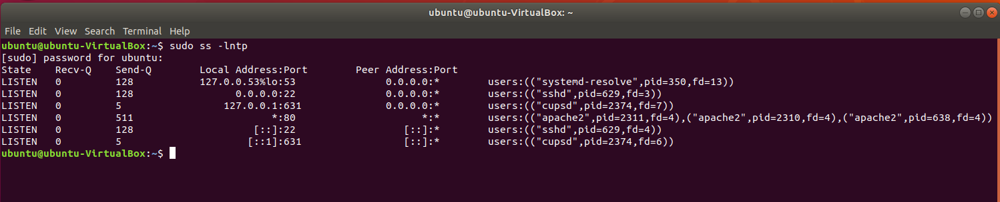

### 1.2 Verify Ubuntu's IPv4 Address

```bash
ip -4 addr show
```

**Command explanation:**

- `ip` — Displays and manages Linux networking information.
- `-4` — Restricts output to IPv4.
- `addr show` — Displays assigned interface addresses.

**Observed address:** `172.16.77.10/24`

### 1.3 Verify the Apache HTTP Service

Test the Apache service locally:

```bash
wget --spider -S http://127.0.0.1
```

**Command explanation:**

- `wget` — Retrieves resources from web servers.
- `--spider` — Checks a resource without downloading its contents.
- `-S` — Displays HTTP response headers.
- `127.0.0.1` — The local loopback address.

**Observed result:** `HTTP/1.1 200 OK`

This confirms Apache is running and responding to local HTTP requests.

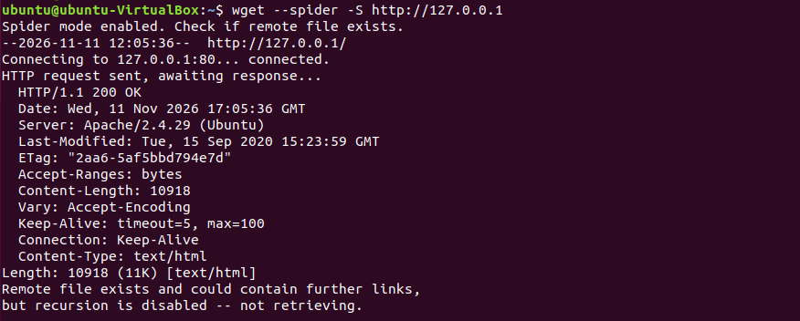

## Task 2 — Establish Baseline Connectivity

Before modifying the firewall, verify that the default WAN policy blocks unauthorized access to the internal network.

### 2.1 Test HTTP Connectivity from Kali

On Kali, run:

```bash
wget --spider -S -T 5 -t 1 http://172.16.77.10
```

**New parameters:**

- `-T 5` — Sets a five-second network timeout.
- `-t 1` — Limits the request to one attempt.
- `172.16.77.10` — Ubuntu's destination IPv4 address.

**Observed result:** Connection timed out.

### 2.2 Test ICMP Connectivity

```bash
ping -c 4 172.16.77.10
```

**Command explanation:**

- `ping` — Tests connectivity using ICMP echo requests.
- `-c 4` — Sends four echo requests.

**Observed result:** Four packets transmitted, zero received (100% packet loss).

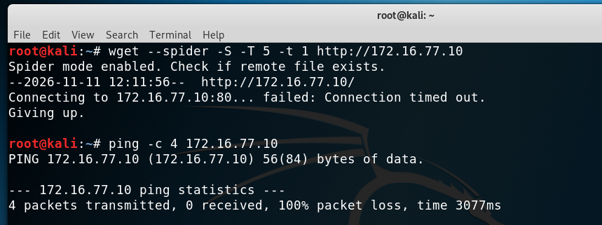

### 2.3 Verify Denied Traffic in pfSense

In pfSense:

1. Navigate to **Status → System Logs → Firewall**.
2. Locate traffic originating from `192.168.50.10`.
3. Identify denied HTTP and ICMP traffic destined for `172.16.77.10`.

**Observed result:** The default IPv4 WAN deny rule (`1000000103`) blocked the connection attempts.

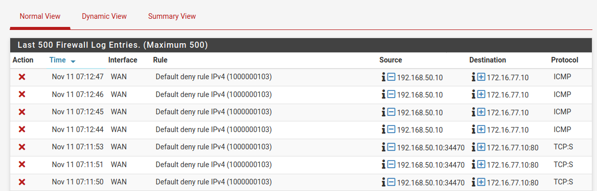

## Task 3 — Configure a Least-Privilege Firewall Rule

### 3.1 Create a pfSense Snapshot

Before modifying firewall policies, create a VirtualBox snapshot of the pfSense VM.

**Snapshot name:** `Exercise-01-Pre-Firewall-Change`

This provides a rollback point if configuration changes cause unexpected behavior.

### 3.2 Configure the HTTP Allow Rule

In pfSense:

1. Navigate to **Firewall → Rules → WAN**.
2. Add a new firewall rule.
3. Configure the following settings:

| Setting | Value |
|---|---|
| Action | Pass |
| Interface | WAN |
| Address Family | IPv4 |
| Protocol | TCP |
| Source | Single host: `192.168.50.10` |
| Source Port | Any |
| Destination | Single host: `172.16.77.10` |
| Destination Port | HTTP (80) |
| Log Packets | Enabled |
| Description | `EX01 - Allow Kali HTTP to Ubuntu` |

4. Save the rule.
5. Click **Apply Changes**.
6. Verify the new rule appears above the existing ICMP rule.

The firewall now permits Kali to initiate TCP 80 connections to Ubuntu without granting access to other internal services.

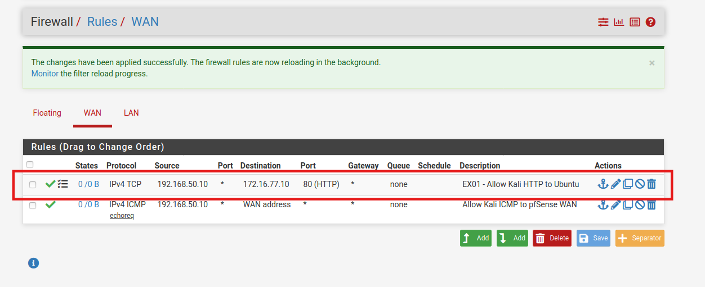

## Task 4 — Validate Authorized and Unauthorized Traffic

### 4.1 Verify Authorized HTTP Connectivity

From Kali, repeat the HTTP test:

```bash
wget --spider -S -T 5 -t 1 http://172.16.77.10
```

**Expected result:** `HTTP/1.1 200 OK`

During testing, the initial connection timed out despite the firewall permitting the incoming TCP SYN packets.

The issue was traced to Ubuntu's missing return route. See the **Troubleshooting** section for the investigation and resolution.

After correcting the route, the test returned:

**Observed result:** `HTTP/1.1 200 OK`

**Screenshot 06 — Kali to Ubuntu HTTP Allowed**

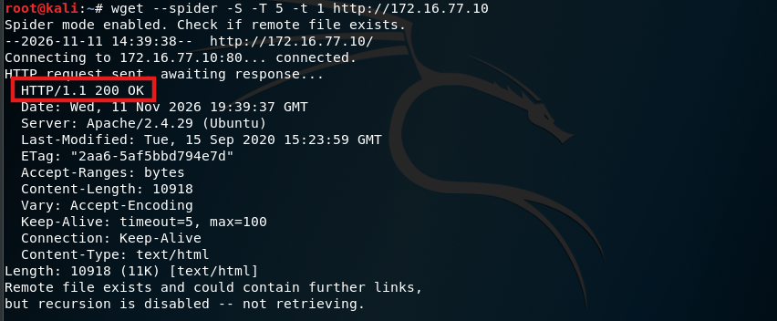

### 4.2 Verify Unauthorized SSH Access Remains Blocked

From Kali, run:

```bash
nc -zv -w 5 172.16.77.10 22
```

**Command explanation:**

- `nc` — Netcat, a TCP/UDP networking utility.
- `-z` — Checks a port without sending application data.
- `-v` — Enables verbose output.
- `-w 5` — Sets a five-second timeout.
- `22` — SSH destination port.

**Observed result:** Connection timed out.

### 4.3 Verify ICMP Remains Blocked

```bash
ping -c 4 172.16.77.10
```

**Observed result:** Four packets transmitted, zero received.

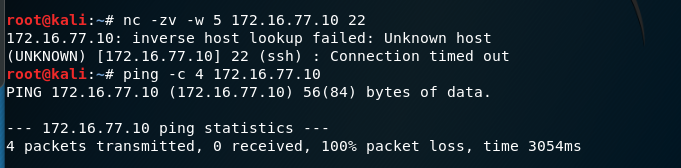

### 4.4 Confirm the Access Restrictions

| Protocol | Destination | Observed Result |
|---|---|---|
| HTTP (TCP 80) | `172.16.77.10` | Allowed |
| SSH (TCP 22) | `172.16.77.10` | Blocked |
| ICMP | `172.16.77.10` | Blocked |

The HTTP rule successfully permitted the required service while preserving restrictions against other traffic.

## Task 5 — Inspect Stateful Connections

### 5.1 Generate an Authorized Connection

From Kali, run:

```bash
wget --spider -S -T 5 -t 1 http://172.16.77.10
```

### 5.2 Inspect the pfSense State Table

In pfSense:

1. Navigate to **Diagnostics → States**.
2. Filter for `192.168.50.10` or `172.16.77.10`.
3. Locate the HTTP connection between Kali and Ubuntu.

**Observed connection:**

| Field | Value |
|---|---|
| Interface | WAN |
| Protocol | TCP |
| Source | `192.168.50.10:58694` |
| Destination | `172.16.77.10:80` |
| State | `FIN_WAIT_2:FIN_WAIT_2` |
| Packets | 6 / 4 |
| Bytes | 460 B / 527 B |

The bidirectional packet counters demonstrate that pfSense tracked both directions of the authorized HTTP connection.

The `FIN_WAIT_2` state indicates that the connection was in the process of closing following the HTTP request.

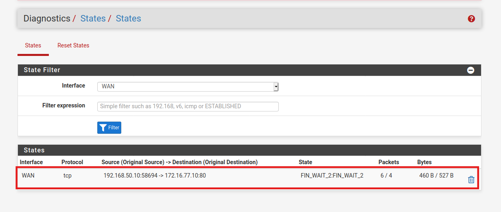

## Task 6 — Review Firewall Logs

### 6.1 Identify Permitted HTTP Traffic

In pfSense:

1. Navigate to **Status → System Logs → Firewall**.
2. Locate traffic matching the HTTP allow rule.
3. Verify the source, destination, protocol, and rule description.

**Observed log details:**

| Field | Value |
|---|---|
| Interface | WAN |
| Action | Pass |
| Source | `192.168.50.10` |
| Destination | `172.16.77.10:80` |
| Protocol | TCP |
| Rule | `EX01 - Allow Kali HTTP to Ubuntu` |

The firewall logs confirmed that the HTTP traffic matched the intended allow rule.

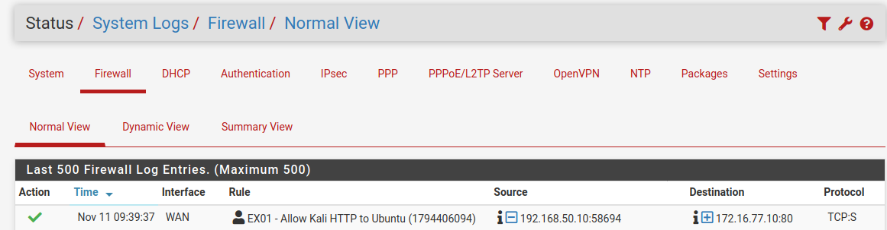

### 6.2 Compare Allowed and Denied Events

Compare the permitted HTTP events with the default-deny entries captured during Task 2.

Confirm that:

- HTTP traffic matched the temporary allow rule.
- Unauthorized SSH and ICMP traffic remained restricted.
- Firewall logs identified the policy responsible for each recorded action.

## Task 7 — Restore the Baseline

### 7.1 Remove the Temporary HTTP Rule

In pfSense:

1. Navigate to **Firewall → Rules → WAN**.
2. Delete `EX01 - Allow Kali HTTP to Ubuntu`.
3. Click **Apply Changes**.
4. Verify the original ICMP rule remains in place.

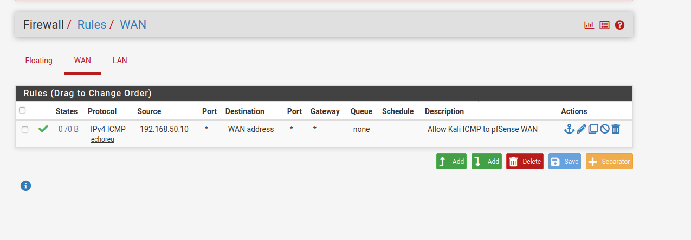

### 7.2 Inspect Remaining Connection States

Navigate to **Diagnostics → States**.

Filter for Kali's address:

`192.168.50.10`

If any HTTP connection states between Kali and Ubuntu remain, remove only those states.

Do not reset unrelated connections.

### 7.3 Verify HTTP Is Blocked Again

From Kali, run:

```bash
wget --spider -S -T 5 -t 1 http://172.16.77.10
```

**Observed result:** Connection timed out.

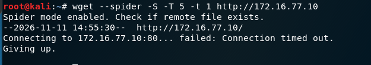

The firewall baseline has been restored.

## Troubleshooting

### Issue 1 — HTTP Times Out Despite the Firewall Allow Rule

**Symptoms:**

- Kali's HTTP request timed out.
- pfSense logged permitted TCP SYN packets.
- Ubuntu's Apache service responded locally.

**Investigation:**

On Ubuntu, inspect the route to Kali:

```bash
ip route get 192.168.50.10
```

**New command explanation:**

- `ip route get` — Displays the route the operating system would use to reach a specified destination.

**Observed result:**

`RTNETLINK answers: Network is unreachable`

Inspect the routing table:

```bash
ip route show
```

**New parameter:**

- `route show` — Displays the system routing table.

Ubuntu had a directly connected route to `172.16.77.0/24`, but no route to Kali's `192.168.50.0/24` network.

**Resolution:**

Add a temporary route:

```bash
sudo ip route add 192.168.50.0/24 via 172.16.77.1
```

**New parameters:**

- `route add` — Adds a route to the routing table.
- `192.168.50.0/24` — Destination network.
- `via 172.16.77.1` — Next-hop gateway, pfSense LAN.

Verify the route:

```bash
ip route get 192.168.50.10
```

**Observed result:** Traffic to Kali was routed through `172.16.77.1`.

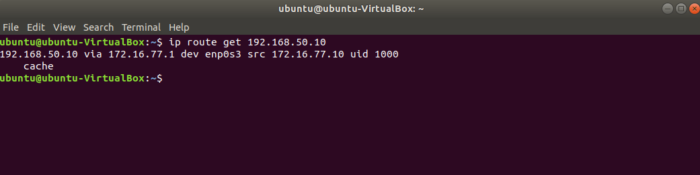

After the routing correction, Kali successfully accessed Apache over HTTP.

### Issue 2 — Temporary Route Does Not Survive a Reboot

A route added using `ip route add` is temporary and is not automatically retained after reboot.

**Investigation:**

Identify Ubuntu's network configuration:

```bash
ls /etc/netplan/
cat /etc/netplan/network-manager-all.yaml
```

**New commands:**

- `ls` — Lists directory contents.
- `cat` — Displays file contents.

The configuration specified NetworkManager as the network renderer.

Identify the active connection profile:

```bash
nmcli connection show --active
```

**Command explanation:**

- `nmcli` — NetworkManager's command-line interface.
- `connection show` — Displays connection profiles.
- `--active` — Restricts output to active connections.

**Observed profile:** `Wired connection 1`

**Resolution:**

Add the route to the saved NetworkManager profile:

```bash
sudo nmcli connection modify "Wired connection 1" +ipv4.routes "192.168.50.0/24 172.16.77.1"
```

**New parameters:**

- `connection modify` — Modifies a saved connection profile.
- `+ipv4.routes` — Appends a static IPv4 route.
- `"192.168.50.0/24 172.16.77.1"` — Destination subnet and gateway.

Verify the saved route:

```bash
nmcli -g ipv4.routes connection show "Wired connection 1"
```

**New parameter:**

- `-g ipv4.routes` — Displays only the configured IPv4 routes.

Reboot Ubuntu:

```bash
sudo reboot
```

After reboot, confirm the route remains active:

```bash
ip route get 192.168.50.10
```

**Observed result:** The route persisted after reboot.

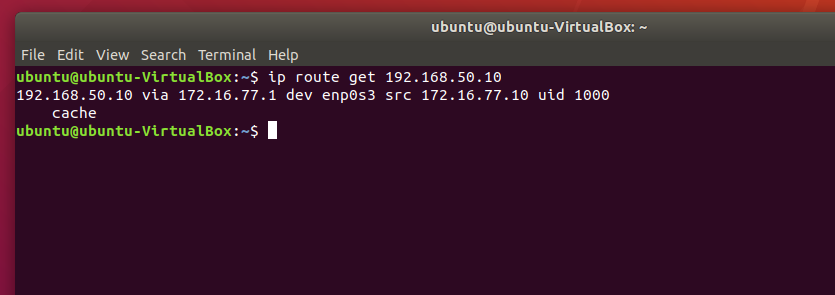

### Issue 3 — Firewall Logs Do Not Show Expected Traffic

**Symptoms:** Expected firewall events were not visible during initial log inspection.

**Cause:** An incorrect time filter was applied.

**Resolution:** Correct the firewall log time filter and locate the corresponding WAN traffic entries.

### Issue 4 — Netcat Reports an Inverse Host Lookup Failure

During SSH testing, Netcat reported an inverse host lookup failure.

This indicates that reverse DNS resolution was unsuccessful. It does not establish whether the destination service is accessible.

The SSH connection timed out, consistent with the intended firewall restriction.

## Final Validation

| Assessment | Observed Result | Status |
|---|---|---|
| Internal service discovery | Apache TCP 80 identified | Pass |
| Local Apache verification | HTTP 200 OK | Pass |
| Baseline HTTP restriction | Connection timed out | Pass |
| Baseline ICMP restriction | 100% packet loss | Pass |
| Least-privilege HTTP rule | Configured and applied | Pass |
| Authorized HTTP connection | HTTP 200 OK | Pass |
| Unauthorized SSH connection | Connection timed out | Pass |
| Unauthorized ICMP connection | 100% packet loss | Pass |
| Stateful connection tracking | Bidirectional traffic recorded | Pass |
| Firewall log inspection | Permit and deny events verified | Pass |
| Persistent return route | Verified after reboot | Pass |
| Firewall baseline restoration | HTTP connection timed out | Pass |


## Cleanup & Reset

After completing the exercise, restore the original firewall restrictions while preserving the network configuration required for subsequent exercises.

### 1. Remove the Temporary Firewall Rule

In pfSense:

1. Navigate to **Firewall → Rules → WAN**.
2. Locate the rule named `EX01 - Allow Kali HTTP to Ubuntu`.
3. Click the trash icon to delete the rule.
4. Click **Apply Changes**.
5. Confirm the rule is no longer present.
6. Verify the original `Allow Kali ICMP to pfSense WAN` rule remains enabled.

### 2. Clear Remaining HTTP Connection States

In pfSense:

1. Navigate to **Diagnostics → States**.
2. Enter `192.168.50.10` in the filter expression.
3. Click **Filter**.
4. Identify any remaining TCP connections between `192.168.50.10` and `172.16.77.10:80`.
5. Delete only those specific connection states, if present.

**Note:** Do not use **Reset States** to clear the entire state table. Existing connections unrelated to this exercise should remain unaffected.

### 3. Verify Firewall Restrictions

On Kali, run:

```bash
wget --spider -S -T 5 -t 1 http://172.16.77.10
```

**Expected result:** Connection timed out.

Optionally, verify that ICMP and SSH remain blocked:

```bash
ping -c 4 172.16.77.10
nc -zv -w 5 172.16.77.10 22
```

**Expected results:**

- HTTP (TCP 80): Connection timed out.
- ICMP: 100% packet loss.
- SSH (TCP 22): Connection timed out.

### 4. Verify the Ubuntu Return Route

The persistent route configured during troubleshooting should remain in place for subsequent exercises.

On Ubuntu, run:

```bash
ip route get 192.168.50.10
```

**Expected result:** Traffic to `192.168.50.10` routes through `172.16.77.1`.

Do not remove this route during cleanup.

### 5. Confirm the Final Lab Configuration

| Component | Required Final State |
|---|---|
| pfSense WAN | Temporary HTTP allow rule removed |
| pfSense ICMP Rule | Original rule preserved |
| pfSense State Table | No remaining exercise-specific HTTP states |
| Kali → Ubuntu HTTP | Blocked |
| Kali → Ubuntu SSH | Blocked |
| Kali → Ubuntu ICMP | Blocked |
| Ubuntu Return Route | Persistent route retained |
| VirtualBox | All four VMs remain available for subsequent exercises |

**Final state:** The original firewall access restrictions are restored, temporary exercise-specific connections are cleared, and the lab is ready for Exercise 2.


